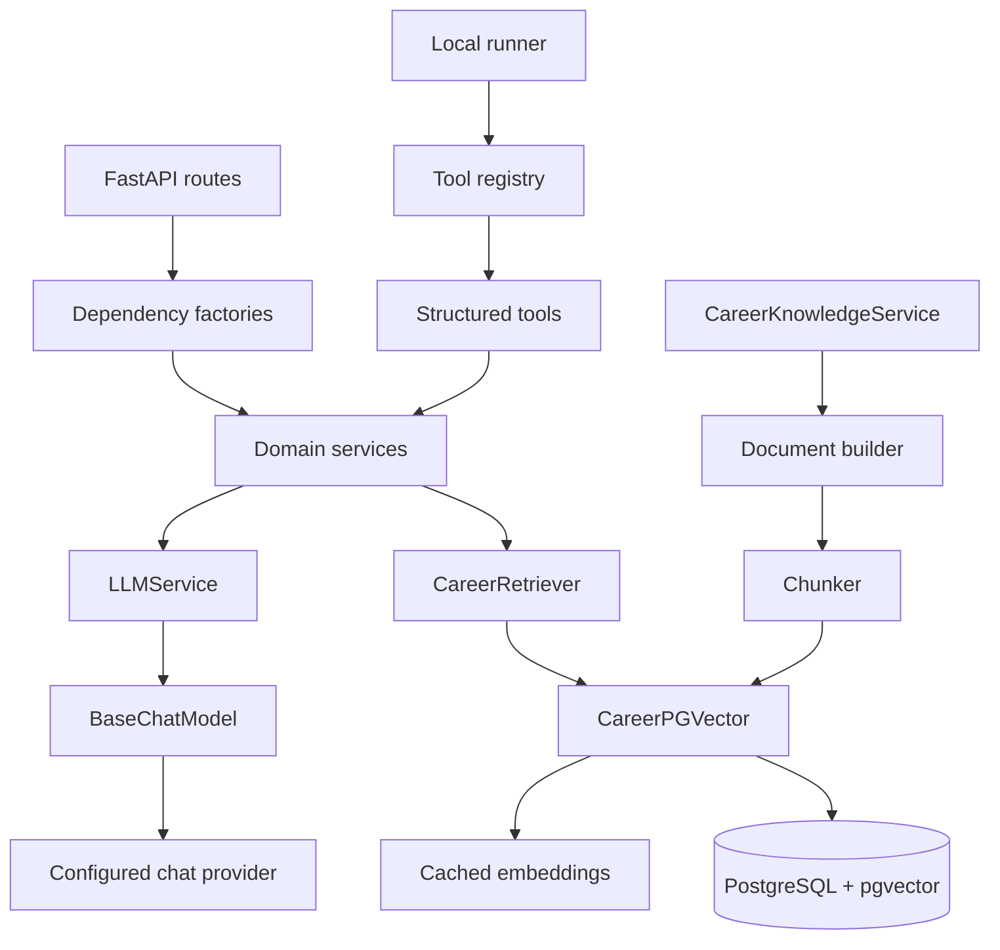

# System architecture

Routes and tools are delivery adapters around the same services. `LLMService` isolates providers; `CareerRetriever` isolates search; `knowledge/store.py` isolates PostgreSQL. `get_chat_model`, `get_embedding_model`, and `get_vector_store` use `lru_cache`, while lightweight service wrappers are created by FastAPI dependencies.

Remote inference dominates generation latency. PDF parsing runs in a thread pool; model and vector operations use async APIs. The repository has no queue, circuit breaker, or explicit backpressure.
