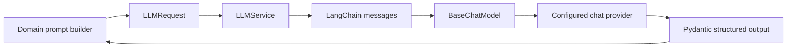

# LLM infrastructure

## Design

An LLM predicts tokens from context; JobAstra constrains that probabilistic behavior with prompts, schemas, and post-validation. `LLMService` is the provider-neutral boundary: domain code sends `LLMRequest` messages and receives `LLMResponse` or a Pydantic model.

## Code mapping and flow

- `llm/config.py`: `LLMSettings` loads `LLM_*`; API keys use `SecretStr`.
- `llm/models.py`: `create_chat_model` selects a supported provider adapter; `get_chat_model` caches it.
- `llm/schemas.py`: roles are limited to system/user/assistant and requests require messages.
- `llm/services.py`: sync/async plain and structured calls; message translation; response normalization.
- `llm/errors.py`: configuration, invocation, timeout, and output-validation errors.
- `prompts/templates.py`: immutable named/versioned templates with named-placeholder validation.
- `prompts/registry.py`: an in-memory registry exists, although domain prompts are imported directly rather than registered centrally.

`with_structured_output(PydanticType)` delegates schema steering to the provider integration, then `_validate_structured_output` validates again. This is safer than manually extracting JSON, although model/provider support is required. Temperature defaults to zero for more repeatable extraction; zero does not guarantee determinism.

Async calls avoid blocking the event loop during network waits. Sync methods support non-async consumers. Provider retries are configured in model constructors. `LLMService` walks exception chains to classify Python/httpx timeout errors and suppresses raw provider details from public error messages.

## Trade-offs and edge cases

LangChain makes providers replaceable and supplies structured output/tool calling. Direct SDKs would expose provider-specific controls and reduce abstraction, but spread provider details through domain code. Capability is model-dependent: an agent model must support tools and structured outputs. There is no fallback provider, token/cost accounting, rate limiter, streaming, or circuit breaker. See the provider timeout mismatch in [setup](05-setup-and-configuration.md).

## Design rationale

Structured output converts probabilistic text into validated domain contracts and rejects malformed scores, enums, and fields. Keeping prompts outside routes makes services reusable by HTTP and tools. Pydantic validates shape rather than truth; grounding prompts, retrieval, and source filtering address factuality.

For step-by-step extension instructions, see [Adding models and providers](22-adding-models-and-providers.md).
