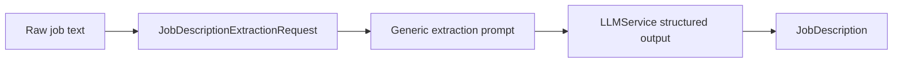

# Job description intelligence

`jobs/schemas.py` models optional title, company, location, work mode, employment type, seniority, responsibilities, required/preferred skills, and experience/education requirements. Optional fields preserve “unknown” rather than inventing defaults. `jobs/prompts.py` normalizes technology names, separates mandatory from preferred qualifications, and applies to engineering, product, data, and other categories. `JobDescriptionService.extract` is a thin structured-call wrapper used by both `/api/jobs/extract` and `analyze_job_description`.

The design produces a stable downstream comparison contract. It cannot guarantee that ambiguous wording is classified correctly, and no deterministic taxonomy or rule engine verifies LLM extraction. A hybrid approach could use rules for explicit phrases and the LLM for ambiguous prose.

Separating extraction from matching creates reusable, reviewable facts. Matching can compare two structured objects plus retrieved evidence without repeatedly interpreting raw text.
