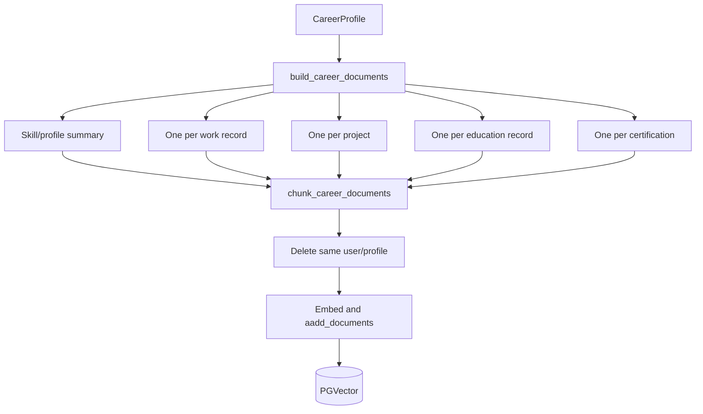

# Career knowledge base

## From structured profile to retrievable evidence

Structured profiles are excellent for validation but poor retrieval units. `knowledge/documents.py` creates human-readable, independently searchable LangChain `Document`s. Metadata contains only `user_id`, `profile_id`, `source_type`, and stable ordinal `source_id`; content stays in `page_content`. Parent IDs are `user:profile:source`.

`chunk_career_documents` leaves documents of at most 800 characters intact and recursively splits longer ones with 100-character overlap. Every chunk inherits metadata and receives deterministic `:chunk-N` identity plus index/count. Overlap reduces boundary loss but duplicates tokens and may produce repeated retrieval results.

`CareerKnowledgeService.index_profile` deletes all documents matching normalized user/profile metadata, then adds current chunks. This prevents accumulation during full-profile re-indexing. `CareerPGVector.adelete_by_metadata` uses PGVector internals and a JSONB filter. `get_vector_store` caches the store/pool and shared embedding model.

## Limitations and design considerations

Deletion and insertion are not transactional: a failure after deletion can leave no profile. Ordinal IDs shift when list order changes, although full replacement avoids duplicates. Empty profiles delete old entries and add none. There is no versioning, migration strategy, batch queue, database-level tenant policy, encryption policy, or operational index tuning.

**Why documents instead of embedding one profile JSON?**

Smaller semantic units improve precision and attribution.

**Why metadata filtering?**

Similarity alone has no tenant concept; user metadata narrows the candidate set. Application authorization must still ensure the caller is allowed to use that user ID.

For backend replacement and data-migration instructions, see [Changing the vector store](24-changing-vector-store.md).
