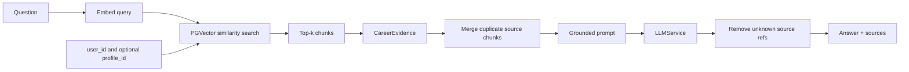

# Career RAG

Retrieval-augmented generation supplies external evidence at request time. Unlike fine-tuning, it updates when documents are re-indexed and can return sources; it does not change model weights.

`CareerRetriever.retrieve` validates inputs, enforces `top_k` 1–10, and always sends a `user_id` metadata filter. An optional `profile_id` exists at service level. It preserves `source_id`, `source_type`, and content.

`CareerRAGService.answer` returns a fixed insufficient-evidence response without calling the LLM when retrieval is empty. Otherwise it merges chunks from the same source, serializes evidence inside tagged prompt blocks, and tells the model to treat it as data. A regex removes bracketed references that are not among retrieved source IDs. Returned `sources` include all merged evidence, not only sources actually cited in prose.

Top-k controls recall, prompt size, and latency. There is no similarity threshold, reranker, hybrid search, query rewriting, or relevance evaluation, so nonempty results can still be weak. Source-ID sanitization prevents invented IDs, but does not prove every sentence follows evidence. Context windows impose a practical evidence limit.

Tool calling decides *whether and how* to invoke retrieval; RAG is the retrieval-plus-context pattern used by a service or tool.
