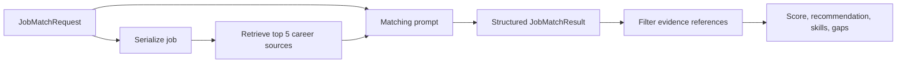

# Job matching engine

`JobMatchRequest` contains `user_id`, `CareerProfile`, and `JobDescription`. `JobMatchingService` retrieves evidence using the serialized job as query, then sends profile, job, and evidence to the model. Required qualifications receive priority; projects count alongside formal work; missing evidence is distinguished from confirmed inability.

`JobMatchResult` validates a 0–100 integer and recommendation literal (`strong_match`, `potential_match`, `weak_match`). The model assigns the score with no deterministic formula or fixed recommendation thresholds. Therefore it is a directional heuristic. Evidence references are retained only when their source IDs were retrieved and their exact case-insensitive claims occur in `matched_skills` or `strengths`.

This approach handles nuanced descriptions and transferable projects, but may vary between calls/models and can reflect model bias. It is unsuitable as an automated hiring decision. A deterministic weighted rubric would be reproducible but brittle; a hybrid could deterministically compute required-skill coverage and let an LLM explain uncertainties. Evaluation should measure extraction correctness, evidence precision, score stability, subgroup fairness, and human agreement.
