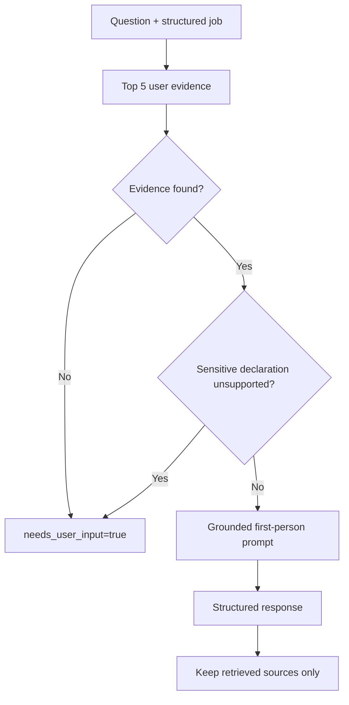

# Application answer generation

`ApplicationAnswerService` combines the question and full job JSON into a retrieval query. With no evidence, it returns `answer=null`. It programmatically detects selected work-authorization/visa and criminal/background phrases and refuses unsupported declarations before invoking the LLM.

The prompt requires first person, professional tone, optional 10–1000 word limits, factual grounding, and missing-information reporting. It treats the job, evidence, and additional instructions as untrusted data. Returned sources are replaced with canonical retrieved documents and deduplicated; model-invented sources are discarded.

Safeguards are partly lexical and partly prompt-based. Synonyms can evade sensitive-term detection, relevant evidence can be absent from top five, and word limits are not programmatically counted after generation. All drafts require human review. The route itself needs authenticated request state, while the tool binds a trusted user ID at construction.
