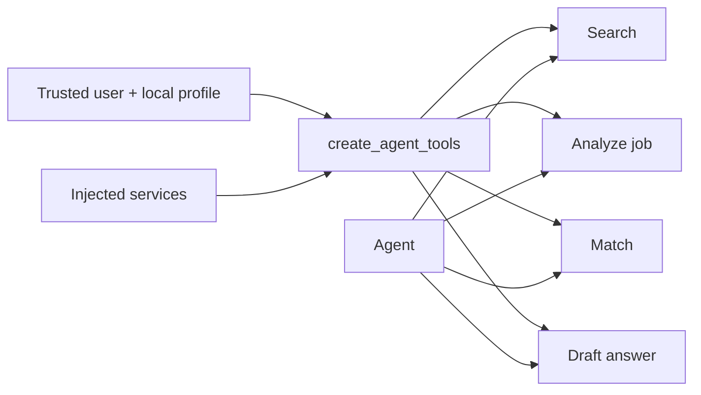

# LangChain tool layer

A tool is a typed callable the model may request; an agent is the runtime that repeatedly chooses and executes tools. `StructuredTool.from_function` derives callable schemas from Pydantic input models, validating model-generated arguments before service execution.

| Tool | Model-visible input | Bound dependency/output |
|---|---|---|
| `search_career_evidence` | query, top-k | bound user ID → evidence |
| `analyze_job_description` | raw job text | `JobDescriptionService` → job |
| `match_job` | structured job | bound user/profile + matching service → result |
| `generate_application_answer` | question, job, word limit | bound user + answer service → draft |

`tools/registry.py` constructs all tools from existing services. The model cannot supply `user_id` or arbitrary candidate profile to user-bound tools. This prevents a tool argument from selecting another tenant, assuming the bound identity is trustworthy. Tool exceptions are handled by LangChain/agent runtime and ultimately wrapped as `AgentExecutionError`; there is no per-tool recovery policy or audit log.
