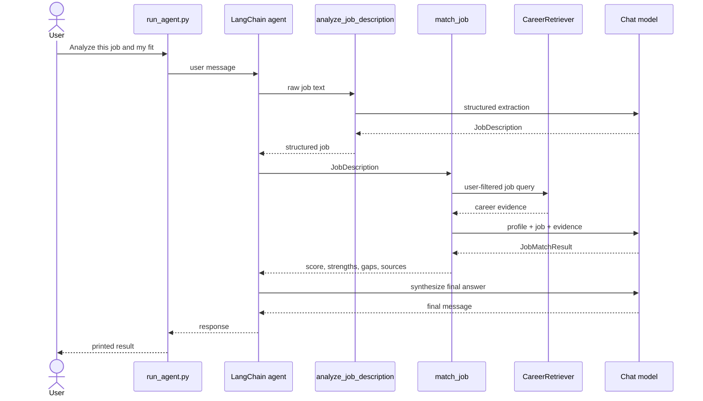

# Single agent

An agent is an LLM-driven loop: inspect messages, choose a tool, consume its result, and repeat until producing a final answer. JobAstra uses `langchain.agents.create_agent` with an already configured model, four tools, and a concise system prompt.

`agent/prompts.py` requires tools for evidence/job work, forbids fabricated candidate facts, treats tool output as untrusted data, and forbids claiming submission. `factory.py` creates the agent without creating clients. `JobAstraAgentService.run` uses `ainvoke` with recursion limit 20, extracts the last message text, and wraps all failures in a sanitized error.

The runner asks for user ID, optional profile, and message, then assembles cached model/store plus services and user-bound tools. Every invocation is a new conversation. There is no public agent endpoint, checkpointing, streaming, approval step, tool-call trace, token usage, model fallback, or repeated-tool detector. A single agent is simpler to debug and sufficient for four related tools; multi-agent coordination would add latency and failure modes without a demonstrated need.
