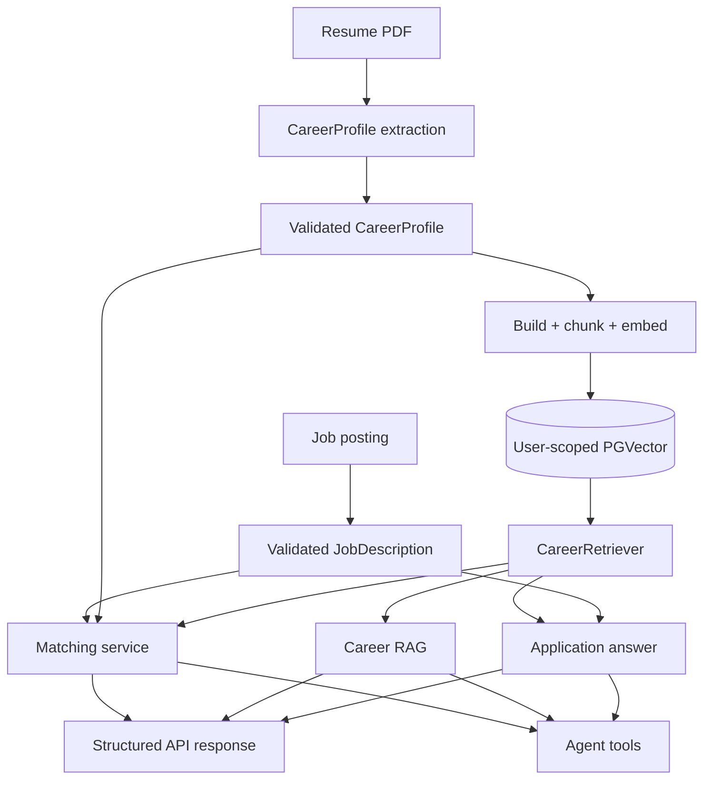

# Data flow and workflows

## End-to-end lifecycle

### Resume extraction

HTTP upload → media/size checks → thread-pooled pypdf extraction → extraction prompt → structured `CareerProfile`.

### Indexing and retrieval

Profile → source documents → 800/100 chunks → delete existing user/profile rows → embed/add → question embedding → metadata-filtered top-k search → `CareerEvidence`.

### Matching and applications

Job requirements drive retrieval. Matching compares profile/job/evidence and validates source references. Application drafting retrieves question-specific evidence, checks sensitive declarations, generates a typed response, and filters sources.

### Complexity

Document creation/chunking is linear in profile text length. Embedding is linear in chunk count times model cost. Remote generation latency/cost scales with prompt/output tokens. Vector search complexity is database/index-dependent. Agent requests may invoke multiple remote calls, so they cost more and take longer than deterministic single-service endpoints.
