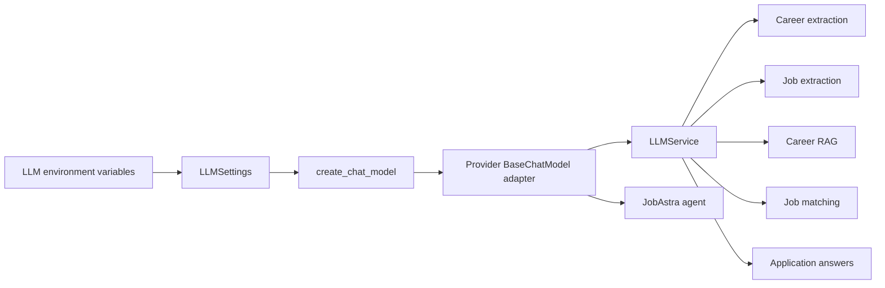

# Adding models and LLM providers

JobAstra isolates chat-provider construction in `src/jobastra_ai/llm/models.py`. Domain services depend on LangChain's `BaseChatModel` through `LLMService`, so a compatible model can serve extraction, RAG, matching, application drafting, and the agent without changing those modules.

There are two different extension paths:

1. Select another model from an already supported provider.
2. Add a provider integration that the model factory does not yet support.

## Select a new model from an existing provider

For an already supported provider, model selection is configuration-driven, so changing model identifiers does not require Python changes.

Update `.env`:

```ini
LLM_PROVIDER=your-provider-name
LLM_MODEL=provider/model-slug
LLM_API_KEY=your-provider-api-key
LLM_TEMPERATURE=0.0
LLM_TIMEOUT=30
LLM_MAX_RETRIES=3
```

For a provider that uses a model name without a namespace:

```ini
LLM_PROVIDER=your-provider-name
LLM_MODEL=your-model-name
LLM_API_KEY=your-provider-api-key
```

Restart the process after editing `.env` because `get_llm_settings()` and `get_chat_model()` are cached with `lru_cache`.

Run the direct connectivity check:

```bash
uv run python scripts/check_llm.py
```

Then exercise both capabilities JobAstra needs:

- **Structured output:** career extraction, job extraction, matching, and application answers call `with_structured_output(...)`.
- **Tool calling:** the local agent must be able to call the four registered LangChain tools.

A model that supports ordinary chat but lacks either capability is not a complete replacement for the JobAstra agent. Provider/model pricing, context windows, rate limits, and feature support can change, so verify them in the provider's current model catalog.

### Model selection checklist

- Accepts system, user, and assistant chat messages.
- Supports Pydantic-compatible structured output through LangChain.
- Supports tool/function calling for `create_jobastra_agent`.
- Has enough context for structured profile, job, and retrieved evidence.
- Produces acceptable extraction accuracy at the chosen temperature.
- Meets latency, cost, privacy, region, quota, and availability requirements.
- Uses a context/output limit large enough for the selected schema.

Temperature defaults to `0.0` because extraction and assessment benefit from lower variability. This improves repeatability but does not make an LLM deterministic.

## Add a new provider

Assume a new provider offers a LangChain chat integration called `ChatProviderModel`.

### 1. Add the integration dependency

Use the provider's official or maintained LangChain package:

```bash
uv add langchain-provider-package
```

This updates both `pyproject.toml` and `uv.lock`. Avoid adding a provider SDK directly unless the LangChain adapter requires it or you intend to write and maintain a `BaseChatModel` adapter.

### 2. Import and construct the chat model

Update `src/jobastra_ai/llm/models.py`:

```python
from langchain_provider_package import ChatProviderModel


def create_chat_model(settings: LLMSettings) -> BaseChatModel:
    provider = settings.provider.strip().lower()

    # Existing provider branches remain here.

    if provider == "new-provider":
        return ChatProviderModel(
            model=settings.model,
            api_key=settings.api_key,
            temperature=settings.temperature,
            timeout=settings.timeout,
            max_retries=settings.max_retries,
        )

    raise LLMConfigurationError(
        f"Unsupported LLM provider: {settings.provider!r}"
    )
```

The factory must return `BaseChatModel`. Keep provider construction in this module so `LLMService` and domain services stay provider-neutral.

Do not copy constructor arguments blindly. Inspect the provider integration for:

- API-key parameter name and accepted secret type
- timeout units and timeout type
- retry semantics and which errors are retried
- model-name parameter name
- structured-output method support
- tool-calling support
- optional base URL, organization, project, region, or headers
- sync and async invocation support

One existing provider integration illustrates why this matters: its installed timeout field is measured in milliseconds, while JobAstra's generic setting is currently treated as seconds. A provider adapter should explicitly convert units at its boundary.

### 3. Decide whether generic settings are sufficient

All providers currently share:

```text
LLM_PROVIDER
LLM_MODEL
LLM_API_KEY
LLM_TEMPERATURE
LLM_TIMEOUT
LLM_MAX_RETRIES
```

If the new provider only needs these values, reuse `LLMSettings`. If it needs unique settings, add optional, clearly named fields to `src/jobastra_ai/llm/config.py`, preferably with the same `LLM_` prefix. Do not make provider-specific fields mandatory for users of other providers.

For example:

```python
base_url: str | None = None
organization: str | None = None
```

These become `LLM_BASE_URL` and `LLM_ORGANIZATION`. Validate provider-required combinations inside the provider branch or with an explicit settings validator. Keep credentials wrapped in `SecretStr` and never log their values.

### 4. Document the environment example

Add a commented example to `.env.example` without a real credential:

```ini
# New provider configuration
# LLM_PROVIDER=new-provider
# LLM_MODEL=your-model-name
# LLM_API_KEY=your-provider-api-key
```

Update the supported-provider list in the root `README.md`, `docs/05-setup-and-configuration.md`, and `docs/07-llm-infrastructure.md`.

### 5. Verify the provider boundary

At minimum, verify these behaviors:

1. `create_chat_model` returns the expected `BaseChatModel` implementation.
2. Unsupported provider names raise `LLMConfigurationError`.
3. A plain async invocation succeeds through `scripts/check_llm.py`.
4. `with_structured_output(CareerProfile)` produces a valid Pydantic model.
5. The model can bind and invoke JobAstra's tools.
6. Authentication, quota, timeout, and network failures are translated by `LLMService` without exposing secrets.
7. Both sync and async paths behave correctly if the provider is intended to support both.

Provider connectivity tests make external calls and may incur cost. Keep them separate from fast unit tests and require explicit credentials.

## Example compatibility smoke check

The following pattern verifies construction and structured-output binding without sending a request:

```python
from jobastra_ai.career.schemas import CareerProfile
from jobastra_ai.llm.config import LLMSettings
from jobastra_ai.llm.models import create_chat_model

settings = LLMSettings(
    provider="new-provider",
    model="your-model-name",
    api_key="placeholder-for-construction-only",
    _env_file=None,
)
model = create_chat_model(settings)
structured_model = model.with_structured_output(CareerProfile)
```

This only proves that the local adapter accepts the configuration. A real API call is still needed to prove credentials, model availability, provider schema enforcement, and network behavior.

## Data flow after adding a provider



The agent receives the configured model directly because it needs native tool calling. Domain services receive the same model through `LLMService` for provider-neutral message conversion and structured output.

## Common failure modes

| Symptom | Likely cause | Check |
| --- | --- | --- |
| `Unsupported LLM provider` | Provider branch/name mismatch | `LLM_PROVIDER` and `models.py` |
| HTTP 401 | Wrong/revoked key or wrong provider | Provider account and `.env` |
| HTTP 402/429 | Billing, quota, or rate limit | Provider usage dashboard |
| Request appears stuck | Long retries or wrong timeout units | Adapter timeout/retry semantics |
| Plain chat works; extraction fails | No compatible structured output | Model/integration capabilities |
| Extraction works; agent fails | No tool calling or incompatible tool schema | Agent model capabilities |
| Invalid Pydantic response | Provider returned incomplete/wrong schema | Model support, prompt, schema, output limits |
| Changed `.env` has no effect | Cached settings/model or shell override | Restart process; inspect environment precedence |

## Engineering trade-offs

The current conditional factory is simple and appropriate for a small provider set. If provider count grows, a registry such as `dict[str, Callable[[LLMSettings], BaseChatModel]]` can reduce branching and support modular adapters. Do not introduce that abstraction until it improves actual maintenance.

One global `LLMSettings` object keeps configuration simple. Separate provider settings become useful when providers need many incompatible options. A common interface improves portability, but provider-specific capabilities still require explicit compatibility checks; abstraction cannot make unsupported tool calling or structured output appear.
