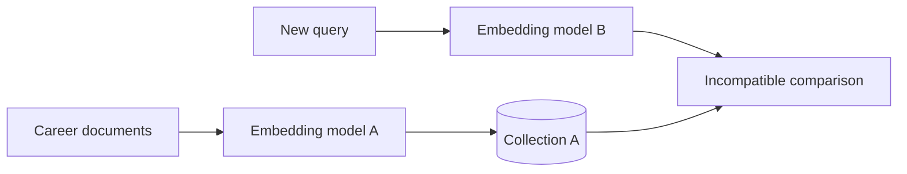
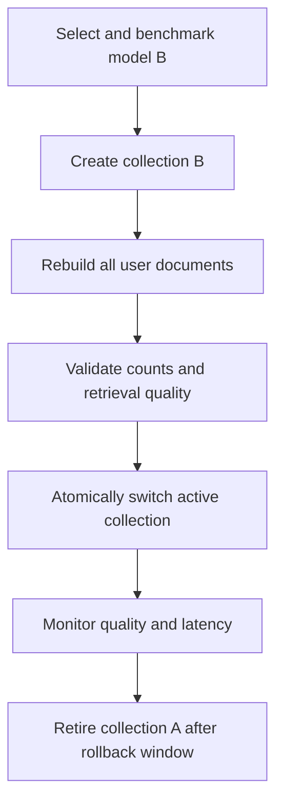

# Changing the embedding model

JobAstra loads its embedding model through `src/jobastra_ai/embeddings/models.py`. The model is selected by environment configuration and returned through LangChain's provider-neutral `Embeddings` interface.

Changing the model requires more than editing `.env`: all stored career documents must be embedded again. Vectors from different models are not comparable, even when both models produce the same number of dimensions.

## Current implementation

`EmbeddingSettings` in `src/jobastra_ai/embeddings/config.py` reads:

```ini
EMBEDDING_MODEL=your-embedding-model-name
EMBEDDING_DEVICE=cpu
```

`create_embedding_model` passes these values to the configured local embedding integration:

```python
return LocalEmbeddings(
    model=settings.model,
    model_kwargs={"device": settings.device},
)
```

`get_embedding_model()` caches one model instance with `lru_cache`. `get_vector_store()` also caches the PGVector store that receives that model. Restart every application and worker process after changing embedding settings.

## Select another local embedding model

Choose a model compatible with the installed local embedding integration and update `.env`:

```ini
EMBEDDING_MODEL=your-embedding-model-name
EMBEDDING_DEVICE=cpu
```

For a supported CUDA environment:

```ini
EMBEDDING_DEVICE=cuda
```

Device availability is not checked by JobAstra before model construction. A CUDA setting requires compatible hardware plus matching PyTorch/CUDA packages. Keep `cpu` when those dependencies are unavailable.

No Python change is needed when the new model can be loaded by the existing embedding integration and constructor.

## Model-selection criteria

Evaluate candidates on the actual career-retrieval workload:

- Retrieval quality for skills, projects, experience, education, and job requirements
- Embedding dimension and database storage cost
- Maximum input length and truncation behavior
- Model download size, RAM/VRAM use, and startup time
- Query and document embedding latency
- Language and domain coverage
- License and redistribution terms
- Trust requirements for models that require downloaded remote code
- Stability and availability of the model revision

Smaller models generally reduce latency and memory at a possible relevance cost. Larger models may improve retrieval but increase ingestion time, query latency, storage, and deployment requirements.

## Why re-indexing is mandatory

An embedding vector only has meaning in the coordinate system learned by its model. A query embedded with model B cannot reliably search documents embedded with model A.



Equal dimensions do not imply compatibility. Different models can map the same text to unrelated coordinates. If dimensions differ, PostgreSQL may also reject inserts or similarity operations depending on the vector schema created by the integration.

## Development migration

For disposable local data, the simplest sequence is:

1. Stop the FastAPI server and local agent processes.
2. Change `EMBEDDING_MODEL` and optionally `EMBEDDING_DEVICE` in `.env`.
3. Use a new collection name to avoid mixing vector spaces:

   ```ini
   VECTOR_COLLECTION_NAME=career_knowledge_v2
   ```

4. Restart the service so cached settings, embedding model, and vector store are rebuilt.
5. Re-index every `CareerProfile` into the new collection through `CareerKnowledgeService.index_profile` or the development indexing endpoint.
6. Run representative retrieval queries and compare relevance.
7. Remove the old collection only after the new collection is complete and validated.

Using a new collection is safer than writing new vectors into the existing collection. It prevents mixed-model retrieval and provides a rollback target.

## Production-safe migration design

The repository does not currently implement embedding migrations. A robust future migration should use versioned collections:



Recommended metadata or operational records should track:

- Embedding model identifier and pinned revision
- Embedding dimension
- Preprocessing/chunking version
- Collection version
- Indexing completion and failure state
- Profile version indexed for each user

The current document metadata does not store an embedding-model version. Isolation therefore depends on using a separate `VECTOR_COLLECTION_NAME` and controlled deployment configuration.

## Re-index through the current API

Start PostgreSQL and FastAPI:

```bash
docker compose up -d
uv run uvicorn jobastra_ai.main:app --app-dir src --reload
```

Then submit each structured profile to:

```text
POST /api/career/knowledge/index
```

The request shape is:

```json
{
  "user_id": "user-123",
  "profile_id": "profile-123",
  "profile": {
    "full_name": null,
    "headline": "Backend Engineer",
    "summary": null,
    "location": null,
    "years_of_experience": null,
    "skills": [{"name": "Python", "level": null, "years_of_experience": null}],
    "work_experience": [],
    "projects": [],
    "education": [],
    "certifications": [],
    "preferences": {
      "target_roles": [],
      "preferred_locations": [],
      "preferred_employment_types": [],
      "industries": [],
      "remote_preferred": null
    }
  }
}
```

This endpoint is development-only because it trusts the supplied `user_id`. A production migration should run through an authenticated administration/background process.

## Validate the new model

### Construction and vector dimension

This command loads the configured model and prints the query-vector dimension:

```bash
uv run python -c "import asyncio; from jobastra_ai.embeddings.models import get_embedding_model; v=asyncio.run(get_embedding_model().aembed_query('Python backend API development')); print('dimension:', len(v))"
```

The first execution may download model files. An unauthenticated model-registry warning is not necessarily an embedding failure; configure the registry's optional access token when higher download limits or gated access are needed.

### Input validation

`EmbeddingService` rejects:

- Non-string query input
- Empty or whitespace-only query text
- A non-list document collection
- An empty document collection
- Empty or non-string items inside the collection

The PGVector store uses the embedding model directly, so retrieval evaluation must also exercise `CareerKnowledgeService` and `CareerRetriever`, not only `EmbeddingService`.

### Retrieval evaluation

Create a small labeled set of questions and expected source IDs. Compare the old and new models using:

- Recall at k: whether a relevant source appears in the top k
- Precision at k: how many retrieved sources are relevant
- Mean reciprocal rank: how early the first relevant source appears
- Latency for query embedding and database search
- Indexing throughput and memory use
- Behavior for exact technology names, synonyms, and ambiguous role language

Do not choose a model solely from public leaderboard scores. Career profiles and job requirements are the relevant domain.

## Changing to a hosted embedding provider

The current model factory always constructs the installed local embedding integration. A hosted provider requires an application-code change similar to the chat-provider factory:

1. Add the provider's maintained LangChain integration dependency.
2. Extend embedding settings with optional provider/API-key fields.
3. Update `create_embedding_model` to select an implementation and still return `Embeddings`.
4. Keep credentials in `SecretStr` and environment variables.
5. Verify both `aembed_query` and `aembed_documents`.
6. Create a new vector collection and re-index everything.
7. Evaluate cost, privacy, rate limits, batching, retries, and regional processing.

A possible future shape is:

```python
def create_embedding_model(settings: EmbeddingSettings) -> Embeddings:
    if settings.provider == "local":
        return LocalEmbeddings(...)
    if settings.provider == "hosted-provider":
        return HostedEmbeddings(...)
    raise EmbeddingConfigurationError(...)
```

The repository does not currently have `EMBEDDING_PROVIDER` or `EmbeddingConfigurationError`; this snippet describes a future extension, not existing behavior.

## Common failure modes

| Symptom | Likely cause | Resolution |
|---|---|---|
| Model download stalls/fails | Network, Hub rate limit, missing gated access | Check connectivity/access; optionally set `HF_TOKEN` |
| CUDA initialization error | Unsupported device or PyTorch/CUDA mismatch | Use `cpu` or install compatible runtime |
| PostgreSQL dimension error | Existing collection/schema uses another dimension | Use a new collection and re-index |
| Retrieval quality collapses | Old and new vector spaces mixed | Rebuild all documents in an isolated collection |
| `.env` change has no effect | Cached settings/model/store or shell override | Restart every process and inspect environment precedence |
| High memory or latency | Model is too large for the deployment device | Benchmark a smaller model, batch ingestion, or use dedicated workers |
| Relevant exact skill is missed | Dense retrieval weakness | Evaluate hybrid lexical/vector search and reranking |

## Rollback

If the new model underperforms, restore the previous `EMBEDDING_MODEL` and `VECTOR_COLLECTION_NAME`, then restart all processes. A versioned collection keeps the old vectors available for this rollback. Never query an old collection with the new embedding model.
