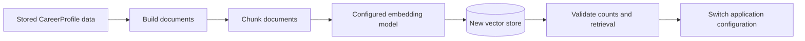
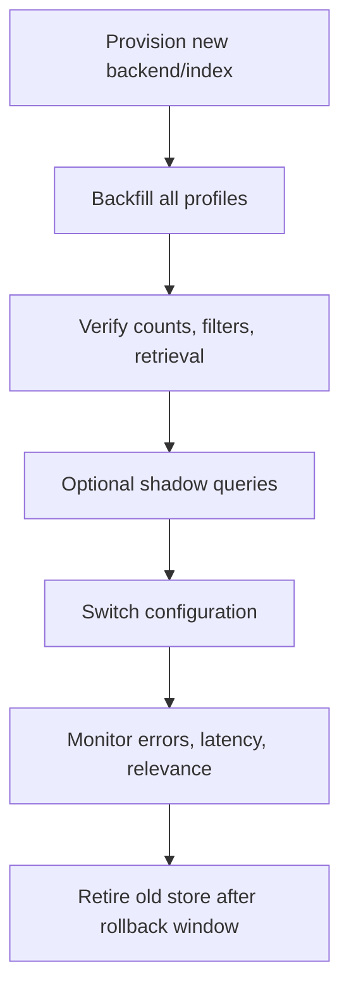

# Changing the vector store

JobAstra currently keeps vector-storage construction and database-specific deletion behavior in `src/jobastra_ai/knowledge/store.py`. The rest of the knowledge pipeline depends on a small set of operations, but its type annotations currently reference the concrete `CareerPGVector` class. Replacing the backend therefore requires both an adapter and limited type/dependency updates.

Changing the vector store is a storage migration. Existing vectors, metadata, document IDs, user boundaries, and embedding compatibility must be preserved or rebuilt before traffic moves to the new backend.

## Current integration boundary

The current knowledge and retrieval code uses these operations:

| Consumer | Required operation | Purpose |
| --- | --- | --- |
| `CareerKnowledgeService` | `adelete_by_metadata(filter)` | Remove an existing user/profile before replacement |
| `CareerKnowledgeService` | `aadd_documents(documents)` | Embed and store new chunks |
| `CareerRetriever` | `asimilarity_search(query, k, filter)` | Retrieve user-scoped evidence |
| FastAPI dependencies | `get_vector_store()` | Reuse one configured store and connection pool |

The backend must accept LangChain `Document` objects containing:

```json
{
  "page_content": "Human-readable career evidence",
  "metadata": {
    "user_id": "user-123",
    "profile_id": "profile-123",
    "source_type": "project",
    "source_id": "project-1",
    "chunk_id": "user-123:profile-123:project-1:chunk-1",
    "chunk_index": 1,
    "chunk_count": 1
  }
}
```

Document IDs and metadata are created in `knowledge/documents.py` and `knowledge/chunking.py`. The replacement store should not require sensitive career content to be copied into metadata.

## Required behavior

A compatible backend or adapter must provide:

1. Asynchronous document insertion.
2. Asynchronous similarity search from raw query text.
3. Metadata filters with exact matching for `user_id` and optional `profile_id`.
4. Deletion by the combined `user_id` and `profile_id` filter.
5. Stable document/chunk identity or an explicit ID mapping.
6. The same embedding model for stored documents and queries.
7. Predictable handling of empty results and backend failures.
8. Reusable clients/connections instead of initialization per request.

User filtering is a mandatory security boundary. A backend that cannot filter before returning results should not be used for multi-user retrieval without a separate secure namespace or tenant-isolated index.

## Recommended adapter protocol

The current services use `CareerPGVector` directly. Before supporting multiple backends, introduce a small application-owned protocol representing only the operations JobAstra needs:

```python
from typing import Protocol

from langchain_core.documents import Document


class CareerVectorStore(Protocol):
    async def aadd_documents(
        self,
        documents: list[Document],
    ) -> list[str]: ...

    async def asimilarity_search(
        self,
        query: str,
        *,
        k: int,
        filter: dict[str, str],
    ) -> list[Document]: ...

    async def adelete_by_metadata(
        self,
        metadata_filter: dict[str, str],
    ) -> None: ...
```

This is a recommended future refactor, not an existing class. Update `CareerKnowledgeService`, `CareerRetriever`, and FastAPI dependencies to accept the protocol. Keep backend SDK objects inside adapter modules.

LangChain vector-store implementations do not all expose identical filter syntax, deletion semantics, return types, or async behavior. The adapter should normalize those differences.

## Add a new backend

Assume the new backend has a maintained Python or LangChain integration.

### 1. Add the dependency

```bash
uv add vector-store-integration-package
```

This updates `pyproject.toml` and `uv.lock`. Prefer the smallest maintained package needed for the selected backend.

### 2. Add independent settings

Vector-store settings currently use the `VECTOR_` prefix in `knowledge/config.py`. Generic configuration could include:

```ini
VECTOR_BACKEND=your-vector-store
VECTOR_DATABASE_URL=your-connection-url
VECTOR_COLLECTION_NAME=career_knowledge_v2
VECTOR_API_KEY=your-vector-store-api-key
```

Only fields required by every backend should be mandatory. Backend-specific credentials or options should be optional for users of other backends and represented with `SecretStr` where sensitive.

Possible additional settings include:

- Endpoint or database URL
- API key or credentials path
- Collection/index/namespace name
- Distance metric
- Embedding dimension
- Region
- Connection-pool limits
- Request timeout and retries

Do not expose credentials through logs, exception messages, or document metadata.

### 3. Implement an adapter

Keep provider-specific code under `knowledge/`, for example:

```text
knowledge/
├── config.py
├── store.py
└── stores/
    ├── __init__.py
    └── new_backend.py
```

Conceptual adapter:

```python
class NewCareerVectorStore:
    def __init__(self, client, embedding_model):
        self._client = client
        self._embedding_model = embedding_model

    async def aadd_documents(self, documents):
        ...

    async def asimilarity_search(self, query, *, k, filter):
        ...

    async def adelete_by_metadata(self, metadata_filter):
        ...
```

If the SDK is synchronous, use an appropriate thread boundary or an async client. Calling blocking network methods directly from FastAPI async handlers reduces concurrency.

### 4. Extend the store factory

Keep selection in one factory so routes and domain services remain backend-neutral:

```python
def create_vector_store(settings, embedding_model) -> CareerVectorStore:
    if settings.backend == "current-backend":
        return create_current_store(settings, embedding_model)
    if settings.backend == "new-backend":
        return NewCareerVectorStore(...)
    raise VectorStoreConfigurationError(...)
```

This illustrates a future design. The current `VectorStoreSettings` has no `backend` field or dedicated configuration exception.

Continue caching the completed store/client factory. A network client, connection pool, and local embedding model should not be recreated for every API request.

## Metadata and tenant isolation

Every similarity query must include the authenticated user's identity:

```python
filter = {"user_id": trusted_user_id}
```

When a specific profile is requested:

```python
filter = {
    "user_id": trusted_user_id,
    "profile_id": profile_id,
}
```

Validate the new backend's filter semantics carefully:

- Confirm equality filters are applied inside the search, not after global top-k retrieval.
- Confirm string normalization does not alter identifiers.
- Confirm nested metadata fields use the expected syntax.
- Confirm filters are supported by the selected index type.
- Confirm an absent or malformed filter fails closed.
- Test that one user cannot retrieve another user's documents.

Metadata filters are not a replacement for authentication or authorization. Production systems should add backend namespaces, database policies, or separate tenant indexes where appropriate.

## Distance metrics and scores

Vector stores may use cosine distance, cosine similarity, inner product, or Euclidean distance. Their score direction and scale differ:

- Similarity often increases as results become more relevant.
- Distance often decreases as results become more relevant.
- Some stores normalize vectors automatically; others do not.

JobAstra currently calls `asimilarity_search` and ignores numeric scores. A compatible adapter can preserve that behavior by returning ordered documents. If future code adds a relevance threshold, normalize score meaning inside the adapter first; do not use one backend's threshold unchanged with another backend.

The distance metric should be compatible with how the embedding model was trained and evaluated.

## Migration strategies

### Re-embed from source profiles

The safest migration rebuilds documents from authoritative `CareerProfile` objects:



This regenerates deterministic metadata and avoids coupling migration code to the old backend's storage schema. The repository itself does not persist authoritative profiles, so an external profile source or export is required for a complete migration.

### Copy vectors directly

Direct vector copying is possible only when:

- The exact embedding model and revision remain unchanged.
- Vector dimensions and numeric precision are compatible.
- Document text, IDs, and metadata can be exported losslessly.
- The destination supports the same distance assumptions.

Re-embedding is usually easier to validate. Direct copying can reduce inference cost for very large datasets but increases migration complexity.

## Safe cutover

Use a parallel collection/index instead of overwriting the active store:



Recommended sequence:

1. Freeze embedding model and chunking configuration for the migration.
2. Provision the new collection with the correct vector dimension and metric.
3. Backfill all users and profiles idempotently.
4. Compare document counts and sample metadata.
5. Run labeled retrieval and tenant-isolation checks.
6. Optionally shadow production queries without serving new results.
7. Atomically switch backend configuration.
8. Monitor latency, errors, empty-result rate, and relevance.
9. Retain the old store for a defined rollback window.
10. Delete old data according to retention and privacy requirements.

The current repository does not implement dual writes, shadow queries, migration checkpoints, or an atomic backend switch.

## Preserve replacement semantics

`CareerKnowledgeService.index_profile` currently performs:

```text
delete documents where user_id + profile_id match
then
insert newly built chunks
```

The new backend must reproduce this behavior so re-indexing does not accumulate duplicates. Prefer an atomic transaction, versioned namespace, or write-then-swap strategy. The current delete-before-insert flow can lose the indexed profile if insertion fails.

Deterministic chunk IDs support idempotency, but not every backend treats supplied document IDs as upserts. Verify whether repeated insertion replaces, rejects, or duplicates records.

## Validation checklist

### Functional checks

- Index a profile and retrieve expected project, skill, work, and education sources.
- Re-index the same profile and confirm no duplicate chunks remain.
- Update a profile and confirm removed sources disappear.
- Index an empty profile and confirm previous entries are removed as intended.
- Verify `top_k` behavior and empty-result handling.
- Verify source IDs/types survive round trips.

### Security checks

- Query user A using user B's relevant keywords and confirm no cross-user result.
- Verify missing user filters are rejected.
- Verify profile filtering cannot escape the bound user.
- Confirm credentials and career content are absent from logs and error responses.

### Operational checks

- Connection/client reuse under concurrent requests
- Query and insertion latency
- Batch-ingestion throughput
- Retry and timeout behavior
- Rate limits and quota failures
- Backup, restore, retention, and deletion behavior
- Index build time and memory/storage consumption

### Retrieval-quality checks

Use a labeled question-to-source dataset and compare recall@k, precision@k, reciprocal rank, empty-result rate, and downstream answer faithfulness. Equal document counts do not prove equivalent retrieval quality.

## Common failure modes

| Symptom | Likely cause | Resolution |
| --- | --- | --- |
| Cross-user results | Filter not applied inside search | Fix adapter and fail closed; add isolation tests |
| No results after migration | Wrong namespace, field mapping, or dimension | Inspect configuration/schema and backfill status |
| Duplicate chunks | IDs ignored or replacement deletion differs | Implement explicit upsert/delete semantics |
| Dimension error | Collection created for another embedding model | Create a compatible collection and re-index |
| Relevance changed | Different metric/index/search defaults | Normalize configuration and evaluate labeled queries |
| API requests block | Synchronous SDK used in async path | Use async client or thread boundary |
| Too many connections | Store/client created per request | Cache the initialized store and configure pooling |
| Deletes are slow | Metadata fields are not indexed | Configure backend metadata indexes or namespaces |
| Partial profile after update | Delete succeeded and insert failed | Use transactions or versioned write-and-swap |

## Rollback

Keep the old backend and its configuration unchanged during the rollback window. If the new backend fails validation or production monitoring, restore the previous vector-store settings and restart all processes that cache the store. Ensure the embedding model also matches the restored collection.

Do not write new-model vectors into the old collection during rollback. Embedding-model migration and vector-store migration should be performed separately unless the migration plan explicitly versions and validates both changes together.
